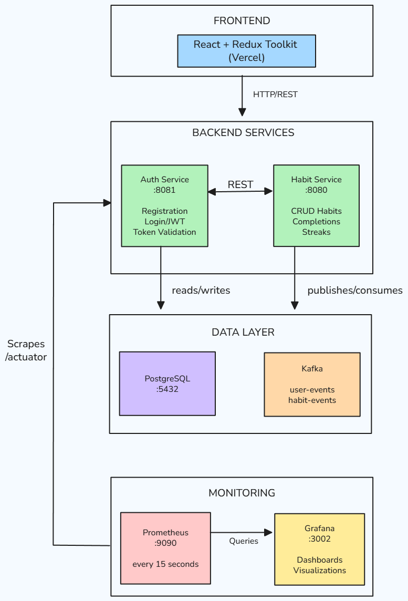
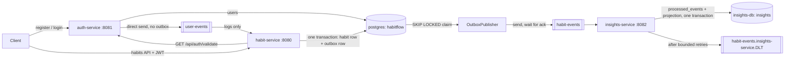
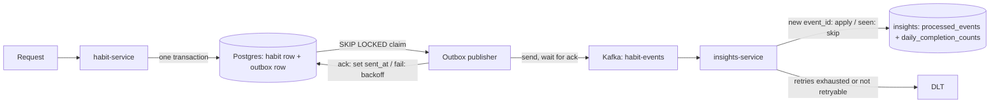

# 🎯 HabitFlow

A habit tracker: a React frontend and three Spring Boot services ([auth](services/auth-service), [habit](services/habit-service),
[insights](services/insights-service)) on PostgreSQL and Kafka. Release R1 makes event delivery reliable: a transactional
outbox, at-least-once publishing with backoff, and an idempotent consumer with a dead-letter topic. Every claim below links
to the file or test that backs it.

**Live Demo:** [habit-tracker-one-murex.vercel.app](https://habit-tracker-one-murex.vercel.app)

[](https://github.com/Amohamed24/habit-tracker/actions/workflows/services-ci.yml) [](https://github.com/Amohamed24/habit-tracker/actions/workflows/ci.yml)

---

## Tech Stack

| Layer | Technologies |
|-------|--------------|
| **Frontend** | React, Redux Toolkit, Vite ([`frontend/package.json`](frontend/package.json)) |
| **Backend** | Java 21, Spring Boot 3.2.0, Spring Kafka ([`services/*/pom.xml`](services/habit-service/pom.xml), [`services-ci.yml`](.github/workflows/services-ci.yml)) |
| **Database** | PostgreSQL 15, two instances ([`docker-compose.yml`](docker-compose.yml)); Flyway in habit-service and insights-service ([habit migrations](services/habit-service/src/main/resources/db/migration), [insights migrations](services/insights-service/src/main/resources/db/migration)); auth-service still uses `ddl-auto: update` ([`application.yml`](services/auth-service/src/main/resources/application.yml)) |
| **Messaging** | Apache Kafka (cp-kafka 7.5.0) with ZooKeeper ([`docker-compose.yml`](docker-compose.yml)) |
| **Monitoring** | Prometheus v2.47.0, Grafana 10.0.0, Spring Actuator ([`monitoring/`](monitoring)) |
| **Testing** | JUnit 5, Testcontainers ([`IntegrationTestBase.java`](services/habit-service/src/test/java/com/habitflow/habits/IntegrationTestBase.java)), k6 from the pinned `grafana/k6:2.3.0` image ([`perf/k6/run.sh`](perf/k6/run.sh)) |
| **CI** | GitHub Actions ([`.github/workflows/`](.github/workflows)) |
| **Deployment** | Frontend on Vercel, the frozen monolith on Railway. The Kafka services in services/ run locally only and are not deployed. |

---

## Architecture


The image above predates R1: it doesn't show insights-service or the outbox. The diagram below does.



Code for each arrow: [`AuthServiceClient.java`](services/habit-service/src/main/java/com/habitflow/habits/client/AuthServiceClient.java) (token validation),
[`HabitService.java`](services/habit-service/src/main/java/com/habitflow/habits/service/HabitService.java) and
[`OutboxWriter.java`](services/habit-service/src/main/java/com/habitflow/habits/outbox/OutboxWriter.java) (outbox write),
[`OutboxPublisher.java`](services/habit-service/src/main/java/com/habitflow/habits/outbox/OutboxPublisher.java),
[auth `KafkaProducer.java`](services/auth-service/src/main/java/com/habitflow/auth/event/KafkaProducer.java),
[habit `KafkaConsumer.java`](services/habit-service/src/main/java/com/habitflow/habits/event/KafkaConsumer.java),
[`HabitEventsListener.java`](services/insights-service/src/main/java/com/habitflow/insights/listener/HabitEventsListener.java),
[`ProjectionService.java`](services/insights-service/src/main/java/com/habitflow/insights/projection/ProjectionService.java),
[`DeadLetterConfig.java`](services/insights-service/src/main/java/com/habitflow/insights/config/DeadLetterConfig.java).

**The monolith is frozen.** [`backend/habitflow`](backend/habitflow) is the original single-service backend. R1 doesn't
change it; [`ci.yml`](.github/workflows/ci.yml) and [`backend-ci.yml`](.github/workflows/backend-ci.yml) still build and test it.

### Services

| Service | Port | Database | Kafka | Config |
|---|---|---|---|---|
| auth-service | 8081 | `habitflow` on `postgres` | produces `user-events` directly | [`application.yml`](services/auth-service/src/main/resources/application.yml) |
| habit-service | 8080 | `habitflow` on `postgres` (shared with auth-service) | outbox → `habit-events` (3 partitions, [`KafkaConfig.java`](services/habit-service/src/main/java/com/habitflow/habits/config/KafkaConfig.java)); consumes `user-events` | [`application.yml`](services/habit-service/src/main/resources/application.yml) |
| insights-service | 8082 | `insights` on `insights-db` (host port 5433) | consumes `habit-events` as group `insights-service`; DLT `habit-events.insights-service.DLT` ([`KafkaConfig.java`](services/insights-service/src/main/java/com/habitflow/insights/config/KafkaConfig.java)) | [`application.yml`](services/insights-service/src/main/resources/application.yml) |

- auth-service and habit-service share one database and the `public` schema, so habit-service's Flyway uses its own
  history table, `flyway_schema_history_habit` ([`application.yml`](services/habit-service/src/main/resources/application.yml)).
- insights-service's datasource defaults to port 5433, so a run without `DB_*` variables can never fall back to the
  `habitflow` database ([`application.yml`](services/insights-service/src/main/resources/application.yml)).
- Both habit-service and insights-service declare `habit-events` with 3 partitions, whichever starts first
  ([`InsightsTopicGuardIT`](services/insights-service/src/test/java/com/habitflow/insights/InsightsTopicGuardIT.java)).

---

## Features

- Registration and login with JWT ([`AuthController.java`](services/auth-service/src/main/java/com/habitflow/auth/controller/AuthController.java), [`JwtService.java`](services/auth-service/src/main/java/com/habitflow/auth/security/JwtService.java))
- Create, read, update and delete habits; toggle today's completion on and off ([`HabitController.java`](services/habit-service/src/main/java/com/habitflow/habits/controller/HabitController.java))
- Daily completion counts per user, built from events ([`ProjectionService.java`](services/insights-service/src/main/java/com/habitflow/insights/projection/ProjectionService.java))
- Prometheus metrics and a provisioned Grafana dashboard ([`monitoring/`](monitoring))

---

## Events

### Envelope v1 (`habit-events`)
Every habit event is wrapped in the same envelope ([`EventEnvelope.java`](services/habit-service/src/main/java/com/habitflow/habits/event/EventEnvelope.java),
[`EventEnvelopeSerializationTest`](services/habit-service/src/test/java/com/habitflow/habits/event/EventEnvelopeSerializationTest.java)):
`event_id`, `event_type`, `event_version`, `occurred_at`, `aggregate_id`, `payload`.

- `event_id` is assigned by the writer when the outbox row is written; it is also the outbox row's primary key
  ([`OutboxWriter.java`](services/habit-service/src/main/java/com/habitflow/habits/outbox/OutboxWriter.java),
  [`V2__outbox.sql`](services/habit-service/src/main/resources/db/migration/V2__outbox.sql)).
- The record value is the envelope as JSON text (`StringSerializer`), the key is `aggregate_id`, and the headers carry
  `event_id`, `event_type` and `event_version`. There is no `__TypeId__` header
  ([`OutboxPublisher.java`](services/habit-service/src/main/java/com/habitflow/habits/outbox/OutboxPublisher.java);
  [`OutboxPublisherIT`](services/habit-service/src/test/java/com/habitflow/habits/OutboxPublisherIT.java) `publish_sendsRecordWithHeaders_andMarksSent`).
- insights-service accepts only `event_version` 1; anything else goes straight to the DLT without retries
  ([`ProjectionService.java`](services/insights-service/src/main/java/com/habitflow/insights/projection/ProjectionService.java),
  [`EventEnvelopeContractTest`](services/insights-service/src/test/java/com/habitflow/insights/event/EventEnvelopeContractTest.java),
  [`RetryClassificationIT`](services/insights-service/src/test/java/com/habitflow/insights/listener/RetryClassificationIT.java) `eventVersion2_dltWithNoRetries`).

Event types, with committed examples:

| `event_type` | Written when | Example |
|---|---|---|
| `habit.created` | a habit is created | [`habit.created.v1.json`](docs/events/habit.created.v1.json) |
| `habit.completed` | a toggle adds today's completion | [`habit.completed.v1.json`](docs/events/habit.completed.v1.json) |
| `habit.completion_undone` | a toggle removes today's completion | [`habit.completion_undone.v1.json`](docs/events/habit.completion_undone.v1.json) |

[`docs/events/habit.completed.v1.json`](docs/events/habit.completed.v1.json):
```json
{
  "event_id": "0b9d7e3a-1c2f-4a5b-8d6e-7f8091a2b3c4",
  "event_type": "habit.completed",
  "event_version": 1,
  "occurred_at": "2026-11-15T15:13:36.932Z",
  "aggregate_id": "9",
  "payload": {
    "habitId": 9,
    "userId": 1,
    "habitName": "Read 20 pages",
    "completionDate": "2026-11-15",
    "completedAt": "2026-11-15T15:13:36.932886"
  }
}
```

### `user-events` (legacy, not on the envelope yet)
auth-service sends a [`UserRegisteredEvent`](services/auth-service/src/main/java/com/habitflow/auth/event/UserRegisteredEvent.java)
(`userId`, `email`, `registeredAt`) with Spring's `JsonSerializer` and the type mapping `userRegistered`
([`application.yml`](services/auth-service/src/main/resources/application.yml)). habit-service only logs it
([`KafkaConsumer.java`](services/habit-service/src/main/java/com/habitflow/habits/event/KafkaConsumer.java)).
Moving it to the envelope is HF-8, not done yet.

### Event flow
1. **Register:** auth-service saves the user, then sends `UserRegisteredEvent` straight to Kafka, with no outbox
   ([`AuthService.java`](services/auth-service/src/main/java/com/habitflow/auth/service/AuthService.java), [`KafkaProducer.java`](services/auth-service/src/main/java/com/habitflow/auth/event/KafkaProducer.java)).
2. habit-service logs the event ([`KafkaConsumer.java`](services/habit-service/src/main/java/com/habitflow/habits/event/KafkaConsumer.java)).
3. **Create habit / toggle on / toggle off:** the habit or completion row and a `habit.created` / `habit.completed` /
   `habit.completion_undone` outbox row are written in one transaction
   ([`HabitService.java`](services/habit-service/src/main/java/com/habitflow/habits/service/HabitService.java),
   [`CreateHabitOutboxIT`](services/habit-service/src/test/java/com/habitflow/habits/CreateHabitOutboxIT.java),
   [`ToggleOutboxIT`](services/habit-service/src/test/java/com/habitflow/habits/ToggleOutboxIT.java)).
4. The outbox publisher sends the row to `habit-events` and sets `sent_at` after the broker acks
   ([`OutboxPublisher.java`](services/habit-service/src/main/java/com/habitflow/habits/outbox/OutboxPublisher.java),
   [`OutboxPublisherScheduledIT`](services/habit-service/src/test/java/com/habitflow/habits/OutboxPublisherScheduledIT.java)).
5. insights-service applies `habit.completed` / `habit.completion_undone` to `daily_completion_counts` once per
   `event_id`, and acknowledges and ignores `habit.created`
   ([`ProjectionService.java`](services/insights-service/src/main/java/com/habitflow/insights/projection/ProjectionService.java),
   [`HabitEventsListenerIT`](services/insights-service/src/test/java/com/habitflow/insights/listener/HabitEventsListenerIT.java) `habitCreated_isAcknowledgedAndIgnored`).

---

## Reliability (R1)

**The problem.** Before R1, habit-service saved to Postgres and then sent to Kafka directly (a dual write; see
[`KafkaProducer.java` at `831e3bc`](https://github.com/Amohamed24/habit-tracker/blob/831e3bc/services/habit-service/src/main/java/com/habitflow/habits/events/KafkaProducer.java)).
If Kafka was slow or down, the request stalled or failed, or the row was saved and the event was lost.

### How it works now
- **Transactional outbox:** the habit row and its event row in `outbox_events` are written in one Postgres
  transaction, and the writer refuses to run outside one
  ([`V2__outbox.sql`](services/habit-service/src/main/resources/db/migration/V2__outbox.sql),
  [`OutboxWriter.java`](services/habit-service/src/main/java/com/habitflow/habits/outbox/OutboxWriter.java);
  [`ToggleOutboxIT`](services/habit-service/src/test/java/com/habitflow/habits/ToggleOutboxIT.java) `outboxWriter_withoutTransaction_throws`).
  A request never waits on Kafka.
- **Publisher:** claims due rows with `FOR UPDATE SKIP LOCKED`, 50 per batch, polling every 500 ms on a single
  scheduler thread, and sets `sent_at` only after the broker acks
  ([`OutboxStore.java`](services/habit-service/src/main/java/com/habitflow/habits/outbox/OutboxStore.java) `CLAIM_SQL`,
  [`application.yml`](services/habit-service/src/main/resources/application.yml) `outbox.*`;
  [`OutboxConcurrencyIT`](services/habit-service/src/test/java/com/habitflow/habits/OutboxConcurrencyIT.java): two
  concurrent publishers over 200 rows give exactly 200 records and 200 `sent_at`, no duplicates).
- **Producer limits:** `acks: all`, idempotence on, `max.block.ms` 5000, `request.timeout.ms` 5000,
  `delivery.timeout.ms` 15000, and one 20000 ms ack deadline per batch (`outbox.send-timeout-ms`)
  ([`application.yml`](services/habit-service/src/main/resources/application.yml)).
- **Retry:** a failed row gets exponential backoff from 1 s with equal jitter, capped at 5 min; the delay is applied on the
  database clock ([`OutboxBackoff.java`](services/habit-service/src/main/java/com/habitflow/habits/outbox/OutboxBackoff.java)
  `BASE_MS`, `CAP_MS`; [`OutboxBackoffTest`](services/habit-service/src/test/java/com/habitflow/habits/outbox/OutboxBackoffTest.java);
  [`OutboxPublisherFailureIT`](services/habit-service/src/test/java/com/habitflow/habits/OutboxPublisherFailureIT.java)
  `backoff_capsAtFiveMinutes`, `rowInBackoff_isNotReclaimedUntilDue`).
- **Idempotent consumer:** insights-service inserts into `processed_events` (primary key `consumer, event_id`) and
  upserts the projection in one transaction; a repeated `event_id` changes nothing
  ([`V1__projection.sql`](services/insights-service/src/main/resources/db/migration/V1__projection.sql),
  [`ProjectionService.java`](services/insights-service/src/main/java/com/habitflow/insights/projection/ProjectionService.java);
  [`ProjectionAtomicityIT`](services/insights-service/src/test/java/com/habitflow/insights/projection/ProjectionAtomicityIT.java),
  [`ProjectionServiceIT`](services/insights-service/src/test/java/com/habitflow/insights/projection/ProjectionServiceIT.java)).
- **Offsets after apply:** auto-commit is off and offsets are committed only after the listener returned
  ([`application.yml`](services/insights-service/src/main/resources/application.yml);
  [`HabitEventsListenerIT`](services/insights-service/src/test/java/com/habitflow/insights/listener/HabitEventsListenerIT.java) `failedApply_isNotCommittedUntilApplyReturns`).
- **Errors:** an `ErrorHandlingDeserializer` turns unreadable records into errors instead of a poll loop; a failing
  record gets 4 attempts, 1 s / 2 s / 4 s apart; `DeserializationException`, `JsonProcessingException` and
  `IllegalArgumentException` go to the DLT without retries; the offset is committed only after the DLT publish succeeded
  ([`DeadLetterConfig.java`](services/insights-service/src/main/java/com/habitflow/insights/config/DeadLetterConfig.java);
  [`RetryClassificationIT`](services/insights-service/src/test/java/com/habitflow/insights/listener/RetryClassificationIT.java),
  [`PoisonPillDltIT`](services/insights-service/src/test/java/com/habitflow/insights/listener/PoisonPillDltIT.java)).
- **Concurrent completion:** two simultaneous completions of the same habit give one `200` and one clean `409`
  instead of a `400` that leaked SQL
  ([`GlobalExceptionHandler.java`](services/habit-service/src/main/java/com/habitflow/habits/config/GlobalExceptionHandler.java);
  [`ConcurrentCompletionIT`](services/habit-service/src/test/java/com/habitflow/habits/ConcurrentCompletionIT.java)).



### Delivery guarantee
**At-least-once on the wire, counted once in the projection.** A row whose ack is lost, or that is retried after a
timeout, can be published again, so duplicates on `habit-events` are expected
([`BrokerOutageProofIT`](services/habit-service/src/test/java/com/habitflow/habits/BrokerOutageProofIT.java) logs them and
doesn't assert them). insights-service counts each `event_id` once
([`DuplicateDeliveryProofIT`](services/insights-service/src/test/java/com/habitflow/insights/listener/DuplicateDeliveryProofIT.java)).

### Failure modes: before and after
"Before" is the audit of commit `831e3bc`, before R1. Every number in the "After" column is a bound asserted by the
cited test or a value in the cited config.

| ID | Before (`831e3bc`) | After (R1) | Proof |
|---|---|---|---|
| L1 | Crash after the DB commit, before the send: event lost (register, createHabit) | **habit-service: fixed.** The event is an outbox row in the same transaction; a failure after the write rolls back both; a failure after the send but before `sent_at` republishes. **register: still open** (direct send). | [`CreateHabitOutboxIT`](services/habit-service/src/test/java/com/habitflow/habits/CreateHabitOutboxIT.java) `exceptionAfterOutboxWrite_rollsBackHabitAndOutboxRow`; [`ToggleOutboxIT`](services/habit-service/src/test/java/com/habitflow/habits/ToggleOutboxIT.java) `exceptionAfterOutboxSave_rollsBackCompletionAndOutboxRow`; [`OutboxPublisherIT`](services/habit-service/src/test/java/com/habitflow/habits/OutboxPublisherIT.java) `exceptionAfterSend_rowStaysUnsent_andIsRepublished` |
| L2 | Broker unreachable: `send` blocks for the default `max.block.ms`, then throws; register returns 400 with the user already committed | **habit-service: fixed.** No Kafka call on the request path: with Kafka unreachable, create and toggle each finish in under 1 s; during a broker pause, each of 50 writes finishes in under 1 s. **register: still open.** | [`ToggleOutboxIT`](services/habit-service/src/test/java/com/habitflow/habits/ToggleOutboxIT.java) `toggle_withKafkaUnreachable_completesUnderOneSecond`; [`CreateHabitOutboxIT`](services/habit-service/src/test/java/com/habitflow/habits/CreateHabitOutboxIT.java) `create_withKafkaUnreachable_completesUnderOneSecond_noKafkaCall`; [`BrokerOutageProofIT`](services/habit-service/src/test/java/com/habitflow/habits/BrokerOutageProofIT.java) `MAX_OP_MS` |
| L3 | Fire-and-forget: an async failure after the default `delivery.timeout.ms` is silently dropped | **habit-service: fixed.** `sent_at` is set only on ack; a failed or timed-out send leaves the row unsent with `attempts`, `last_error` and `next_attempt_at`; after a broker pause, all 50 rows are consumed and marked sent within 60 s. **register: still open.** | [`OutboxPublisherIT`](services/habit-service/src/test/java/com/habitflow/habits/OutboxPublisherIT.java) `failedSend_rowStaysUnsent_laterRowSameAggregateStillPublished`, `unackedSend_timesOutAtDeadline_rowStaysUnsent`; [`OutboxPublisherFailureIT`](services/habit-service/src/test/java/com/habitflow/habits/OutboxPublisherFailureIT.java) `failedFuture_recordsAttemptErrorAndBackoff`, `timedOutFuture_recordsTimeoutAndBackoff`, `brokerDown_contextStarts_batchBacksOff`; [`BrokerOutageProofIT`](services/habit-service/src/test/java/com/habitflow/habits/BrokerOutageProofIT.java) `DELIVERY_WINDOW` |
| L4 | Phantom event: toggle sent inside the transaction, before the commit | **Fixed.** The event is written to the outbox in the same transaction; a rollback removes both; the publisher only sees committed rows. | [`ToggleOutboxIT`](services/habit-service/src/test/java/com/habitflow/habits/ToggleOutboxIT.java) `exceptionAfterOutboxSave_rollsBackCompletionAndOutboxRow`; [`CreateHabitOutboxIT`](services/habit-service/src/test/java/com/habitflow/habits/CreateHabitOutboxIT.java) `exceptionAfterOutboxWrite_rollsBackHabitAndOutboxRow` |
| L5 | Un-completion publishes no event, so projections overcount | **Fixed.** Toggle-off writes one `habit.completion_undone` row (none if there is nothing to undo); completed then undone ends at 0, end to end through Kafka. | [`ToggleOutboxIT`](services/habit-service/src/test/java/com/habitflow/habits/ToggleOutboxIT.java) `toggleOff_writesOneCompletionUndoneRow`, `toggleOff_withNoCompletionToday_writesNoUndoneEvent`; [`ProjectionServiceIT`](services/insights-service/src/test/java/com/habitflow/insights/projection/ProjectionServiceIT.java) `completedThenUndone_isZero`; [`HabitEventsListenerIT`](services/insights-service/src/test/java/com/habitflow/insights/listener/HabitEventsListenerIT.java) `completedThenUndone_viaKafka_endsAtZero` |
| L6 | Listener exception: instant retries, then log and skip; no DLT | **insights-service: fixed.** 4 attempts, 1 s / 2 s / 4 s apart, then the DLT; non-retryable errors go to the DLT after 1 attempt; a transient failure is applied once. **habit-service's `user-events` listener: still open (HF-21).** | [`RetryClassificationIT`](services/insights-service/src/test/java/com/habitflow/insights/listener/RetryClassificationIT.java) `failsTwiceThenSucceeds_appliedOnce_nothingOnDlt`, `permanentRetryableFailure_fourAttemptsThenDlt`, `eventVersion2_dltWithNoRetries`; [`PoisonPillDltIT`](services/insights-service/src/test/java/com/habitflow/insights/listener/PoisonPillDltIT.java) `applyFailure_afterBoundedRetries_landsOnDlt` |
| L7 | Poison pill: `JsonDeserializer` not wrapped in `ErrorHandlingDeserializer`, so a bad record loops forever | **insights-service: fixed.** Malformed JSON lands on the DLT once, with exception headers and the original bytes; the next valid record on the same partition is applied; the offset is committed only after the DLT publish. **habit-service's `user-events` listener: still open (HF-21).** | [`PoisonPillDltIT`](services/insights-service/src/test/java/com/habitflow/insights/listener/PoisonPillDltIT.java) `malformedJson_landsOnDlt_withExceptionHeadersAndOriginalBytes`, `poisonThenValid_samePartition_validIsApplied_noLoop`, `poisonOffset_committedOnlyAfterDltPublishSucceeds` |
| D1 | Consumer crash after processing, before the offset commit: redelivered, applied twice | **Fixed.** `processed_events` and the projection commit together; a redelivery after a restart doesn't double-count; a full replay returns `DUPLICATE` for every record. | [`HabitEventsListenerIT`](services/insights-service/src/test/java/com/habitflow/insights/listener/HabitEventsListenerIT.java) `redeliveryAfterRestart_noDoubleCount`; [`ProjectionAtomicityIT`](services/insights-service/src/test/java/com/habitflow/insights/projection/ProjectionAtomicityIT.java); [`DuplicateDeliveryProofIT`](services/insights-service/src/test/java/com/habitflow/insights/listener/DuplicateDeliveryProofIT.java) `fiveHundredEvents_withDuplicatesReorderingAndReplay_countOnce` |
| D2 | Outbox republish after a crash: duplicate record, with no `event_id` to de-duplicate on | **Fixed at the consumer.** Every event carries a writer-assigned `event_id`; duplicates still reach the topic (at-least-once) and are counted once: 500 distinct events plus 100 exact duplicates count once. | [`EventEnvelopeSerializationTest`](services/habit-service/src/test/java/com/habitflow/habits/event/EventEnvelopeSerializationTest.java); [`ProjectionServiceIT`](services/insights-service/src/test/java/com/habitflow/insights/projection/ProjectionServiceIT.java) `completed_thenSameEventAgain_countsOnce_returnsDuplicate`; [`HabitEventsListenerIT`](services/insights-service/src/test/java/com/habitflow/insights/listener/HabitEventsListenerIT.java) `sameRecordProducedTwice_countsOnce`; [`DuplicateDeliveryProofIT`](services/insights-service/src/test/java/com/habitflow/insights/listener/DuplicateDeliveryProofIT.java) `DISTINCT`, `DUPLICATES` |
| R-1 | Concurrent toggle: the unique-constraint violation returns a 400 containing raw SQL text | **Fixed.** One `200`, one `409`, one completion, one outbox row. | [`ConcurrentCompletionIT`](services/habit-service/src/test/java/com/habitflow/habits/ConcurrentCompletionIT.java) `concurrentToggleOn_one200One409_oneCompletionOneOutboxRow` |

### The two proofs
- **[`DuplicateDeliveryProofIT`](services/insights-service/src/test/java/com/habitflow/insights/listener/DuplicateDeliveryProofIT.java)**
  (insights-service, D1 and D2): 500 distinct envelopes plus 100 exact duplicates, in a seeded shuffled order, through
  real Kafka to the running listener; then the group is rewound to the earliest offset and all 600 records are consumed
  again. Every replayed record must return `DUPLICATE`, and the class must finish in under 90 s (`CI_BOUND`).
- **[`BrokerOutageProofIT`](services/habit-service/src/test/java/com/habitflow/habits/BrokerOutageProofIT.java)**
  (habit-service, L1–L3): the broker is paused with `docker pause` (asserted under 15 s, `MAX_PAUSE_MS`), 25 creates and
  25 toggles run (`HABITS`), each must finish in under 1 s (`MAX_OP_MS`), and every row must fail at least once. After
  the unpause, all 50 `event_id`s must be consumed and every row marked sent within 60 s (`DELIVERY_WINDOW`).
  Duplicates are logged, not asserted.

---

## Monitoring

### Custom Metrics
Micrometer counters ([auth `MetricsConfig.java`](services/auth-service/src/main/java/com/habitflow/auth/config/MetricsConfig.java),
[habit `MetricsConfig.java`](services/habit-service/src/main/java/com/habitflow/habits/config/MetricsConfig.java)), exported by
Actuator at `/actuator/prometheus`:

| Metric | Service | Description |
|--------|---------|-------------|
| `auth_user_registrations_total` | Auth | Total user registrations |
| `auth_user_logins_total` | Auth | Successful logins |
| `auth_user_logins_failed_total` | Auth | Failed login attempts |
| `habits_created_total` | Habit | Total habits created |
| `habits_completed_total` | Habit | Total habit completions |
| `habits_deleted_total` | Habit | Total habits deleted |

There are no outbox-backlog or DLT metrics yet (HF-24).

### Prometheus and Grafana
- Prometheus scrapes auth-service, habit-service and insights-service ([`prometheus.yml`](monitoring/prometheus/prometheus.yml)).
- The provisioned dashboard ([`habitflow-dashboard.json`](monitoring/grafana/dashboards/habitflow-dashboard.json)) has
  these panels: Total User Registrations, Total User Logins, Total Habits Created, Total Habits Completed,
  Request Rate (per second), Average Response Time, JVM Heap Memory Used, Service Health.
- Grafana is on http://localhost:3002, login `admin` / `admin` ([`docker-compose.yml`](docker-compose.yml)).

---

## Getting Started

### Prerequisites
- JDK 21 (Temurin is what CI uses, [`services-ci.yml`](.github/workflows/services-ci.yml)).
- Docker with Compose v2. Testcontainers (the integration tests) needs only a running Docker daemon.
- Node.js 18+, only for the frontend.

On macOS, if `docker` isn't found in your shell, see [Troubleshooting](#docker-command-not-found-on-macos).

### Running locally with Docker Compose
1. **Clone the repository**
   ```bash
   git clone https://github.com/Amohamed24/habit-tracker.git
   cd habit-tracker
   ```

2. **Start the stack**
   ```bash
   docker compose up -d --build
   docker compose ps
   ```
   `postgres`, `kafka`, `insights-db` and `insights-service` have compose healthchecks and show `(healthy)`;
   auth-service and habit-service have none ([`docker-compose.yml`](docker-compose.yml)). Check all three services:
   ```bash
   curl -fsS localhost:8081/actuator/health
   curl -fsS localhost:8080/actuator/health
   curl -fsS localhost:8082/actuator/health
   ```

3. **Access the applications**
   | Service | URL |
   |---------|-----|
   | Auth Service | http://localhost:8081 |
   | Habit Service | http://localhost:8080 |
   | Insights Service | http://localhost:8082 (Actuator only) |
   | Prometheus | http://localhost:9090 |
   | Grafana | http://localhost:3002 |

   Compose doesn't run the frontend; see [`frontend/README.md`](frontend/README.md).

4. **Try the event flow** (see [API Reference](#api-reference) for the endpoints)
   ```bash
   EMAIL="demo-$(date +%s)@example.com"    # unique per run, so the block works more than once
   AUTH=$(curl -fsS -X POST localhost:8081/api/auth/register -H 'Content-Type: application/json' \
     -d "{\"email\": \"$EMAIL\", \"password\": \"password123\"}")
   TOKEN=$(echo "$AUTH" | sed -E 's/.*"token":"([^"]+)".*/\1/')
   USER_ID=$(echo "$AUTH" | sed -E 's/.*"userId":([0-9]+).*/\1/')
   HABIT=$(curl -fsS -X POST localhost:8080/api/habits -H "Authorization: Bearer $TOKEN" \
     -H 'Content-Type: application/json' -d '{"name": "Exercise", "frequency": "DAILY"}' | sed -E 's/.*"id":([0-9]+).*/\1/')
   curl -fsS -X POST localhost:8080/api/habits/$HABIT/toggle -H "Authorization: Bearer $TOKEN"; echo
   # The completion is asynchronous: the outbox publisher (polls every 500 ms) sends it to Kafka, then
   # insights-service consumes it and updates the projection. Poll for up to about 10 s to cover both.
   for i in $(seq 1 20); do
     ROW=$(docker compose exec -T insights-db psql -U postgres -d insights -At -c \
       "SELECT user_id, completion_date, completed_count FROM daily_completion_counts WHERE user_id = $USER_ID")
     [ -n "$ROW" ] && break
     sleep 0.5
   done
   echo "projection: ${ROW:-no row after about 10 s}"
   ```
   The last line shows this user's row, `user_id|today|1`.

5. **Stop**
   ```bash
   docker compose stop     # stops the containers; everything is kept, including Kafka's topics
   docker compose down     # removes the containers; keeps both databases, but not Kafka's topics
   ```
   Postgres data is in the named volumes `postgres_data` and `insights_data`, which survive `down`. Kafka and ZooKeeper
   keep their data in anonymous volumes declared by their images (compose gives them no named volume,
   [`docker-compose.yml`](docker-compose.yml)), so after a `down` the broker starts empty: topic history, DLT records and
   consumer offsets are gone from the running stack (the old anonymous volumes are left behind, detached). Events
   already applied stay in the projection, and unsent outbox rows are still published.
   **Don't add `-v`** unless you mean to delete everything. `docker compose down -v` removes every volume of the stack:
   - `postgres_data` (users, habits, completions, outbox) and `insights_data` (the projection),
   - `prometheus_data` (metrics history) and `grafana_data` (Grafana state),
   - the anonymous volumes holding Kafka's and ZooKeeper's data.

Container names are fixed (`habitflow-db`, `habitflow-kafka`, ...), so only one copy of the stack can run on a machine.

### Running a service on its own
With the compose infrastructure up (`docker compose up -d postgres kafka insights-db`) and the matching compose service
stopped, the defaults in each `application.yml` point at the host ports (Postgres `localhost:5432`, insights
`localhost:5433`, Kafka `localhost:9092`):
```bash
cd services/auth-service && ./mvnw spring-boot:run
cd services/habit-service && ./mvnw spring-boot:run
cd services/insights-service && ./mvnw spring-boot:run
```

---

## API Reference

### Auth Service (Port 8081)
[`AuthController.java`](services/auth-service/src/main/java/com/habitflow/auth/controller/AuthController.java)

| Method | Endpoint | Description |
|--------|----------|-------------|
| POST | `/api/auth/register` | Register new user, returns a JWT |
| POST | `/api/auth/login` | Login and receive a JWT |
| GET | `/api/auth/validate` | Validate a JWT (called by habit-service on every request) |
| GET | `/api/auth/health` | Health check |

Register and login take `email` and `password` (at least 6 characters)
([`RegisterRequest.java`](services/auth-service/src/main/java/com/habitflow/auth/dto/RegisterRequest.java)):
```bash
curl -X POST http://localhost:8081/api/auth/register \
  -H "Content-Type: application/json" \
  -d '{"email": "user@example.com", "password": "password123"}'
```

```bash
curl -X POST http://localhost:8081/api/auth/login \
  -H "Content-Type: application/json" \
  -d '{"email": "user@example.com", "password": "password123"}'
```

### Habit Service (Port 8080)
[`HabitController.java`](services/habit-service/src/main/java/com/habitflow/habits/controller/HabitController.java).
Every `/api/habits` call needs `Authorization: Bearer <token>`
([`AuthenticationFilter.java`](services/habit-service/src/main/java/com/habitflow/habits/security/AuthenticationFilter.java)).

| Method | Endpoint | Description |
|--------|----------|-------------|
| GET | `/api/habits` | Get all habits for user |
| GET | `/api/habits/{id}` | Get specific habit |
| POST | `/api/habits` | Create new habit |
| PUT | `/api/habits/{id}` | Update habit |
| DELETE | `/api/habits/{id}` | Delete habit |
| POST | `/api/habits/{id}/toggle` | Toggle today's completion |
| GET | `/api/habits/health` | Health check |

The body for create and update is `name`, `description`, `frequency`
([`HabitRequest.java`](services/habit-service/src/main/java/com/habitflow/habits/dto/HabitRequest.java)):
```bash
curl -X POST http://localhost:8080/api/habits \
  -H "Content-Type: application/json" \
  -H "Authorization: Bearer <token>" \
  -d '{"name": "Exercise", "description": "Daily workout", "frequency": "DAILY"}'
```

```bash
curl -X POST http://localhost:8080/api/habits/1/toggle \
  -H "Authorization: Bearer <token>"
```
A second toggle on the same day removes the completion and emits `habit.completion_undone`
([`ToggleOutboxIT`](services/habit-service/src/test/java/com/habitflow/habits/ToggleOutboxIT.java)); losing a concurrent
race returns `409 {"error": "COMPLETION_CONFLICT", "completedToday": true}`
([`GlobalExceptionHandler.java`](services/habit-service/src/main/java/com/habitflow/habits/config/GlobalExceptionHandler.java),
[`ConcurrentCompletionIT`](services/habit-service/src/test/java/com/habitflow/habits/ConcurrentCompletionIT.java)).

---

## Project Structure

Trimmed to the main directories and files (`git ls-files` has the rest):
```
habit-tracker/
├── services/
│   ├── auth-service/                 com.habitflow.auth
│   │   └── src/main/java/.../auth/
│   │       ├── config/               SecurityConfig, KafkaConfig, MetricsConfig, GlobalExceptionHandler
│   │       ├── controller/           AuthController
│   │       ├── dto/                  LoginRequest, RegisterRequest, AuthResponse, UserValidationResponse
│   │       ├── entity/               User
│   │       ├── event/                UserRegisteredEvent, KafkaProducer
│   │       ├── repository/           UserRepository
│   │       ├── security/             JwtService
│   │       └── service/              AuthService
│   ├── habit-service/                com.habitflow.habits
│   │   ├── src/main/java/.../habits/
│   │   │   ├── client/               AuthServiceClient
│   │   │   ├── config/               CorsConfig, FilterConfig, KafkaConfig, MetricsConfig, SchedulingConfig, GlobalExceptionHandler
│   │   │   ├── controller/           HabitController
│   │   │   ├── dto/                  HabitRequest, HabitResponse, UserValidationResponse
│   │   │   ├── entity/               Habit, HabitCompletion, OutboxEvent
│   │   │   ├── event/                EventEnvelope, HabitCreatedEvent, HabitCompletedEvent, HabitCompletionUndoneEvent, UserRegisteredEvent, KafkaConsumer
│   │   │   ├── outbox/               OutboxWriter, OutboxStore, OutboxPublisher, OutboxPublisherScheduler, OutboxBackoff, OutboxRow
│   │   │   ├── repository/           HabitRepository, HabitCompletionRepository, OutboxEventRepository
│   │   │   ├── security/             AuthenticationFilter
│   │   │   └── service/              HabitService
│   │   ├── src/main/resources/db/migration/   V1__baseline.sql, V2__outbox.sql, V3__idx_habits_user_id.sql
│   │   └── src/test/java/.../habits/          *IT (failsafe), *Test (surefire)
│   └── insights-service/             com.habitflow.insights
│       ├── src/main/java/.../insights/
│       │   ├── config/               KafkaConfig, DeadLetterConfig
│       │   ├── event/                EventEnvelope
│       │   ├── listener/             HabitEventsListener
│       │   └── projection/           ProjectionService, ApplyResult
│       ├── src/main/resources/db/migration/   V1__projection.sql
│       └── src/test/java/.../insights/        *IT (failsafe), *Test (surefire)
├── backend/habitflow/                the original monolith (frozen)
├── frontend/
│   ├── src/                          api/, components/, pages/, store/ (index.js, authSlice.js, habitsSlice.js), App.jsx, main.jsx
│   ├── package.json
│   └── vite.config.ts
├── monitoring/
│   ├── prometheus/prometheus.yml
│   └── grafana/                      provisioning/ (datasources, dashboards), dashboards/habitflow-dashboard.json
├── perf/
│   ├── k6/                           run.sh, toggle.js
│   └── sql/                          explain.sh, explain-*.sql, seed-*.sql
├── docs/
│   ├── architecture.png
│   ├── events/                       envelope v1 examples
│   ├── perf/                         r1-baseline.md and the raw k6 / EXPLAIN output
│   └── runbooks/                     flyway-baseline-rollback.md
├── .github/workflows/                services-ci.yml, ci.yml, backend-ci.yml, frontend.ci.yml, deploy.yml
├── docker-compose.yml
└── README.md
```
There is no `SecurityConfig` in habit-service: authentication is the `AuthenticationFilter`, registered in
[`FilterConfig.java`](services/habit-service/src/main/java/com/habitflow/habits/config/FilterConfig.java).

---

## Docker Compose Services

From [`docker-compose.yml`](docker-compose.yml):

| Service | Container | Image | Host ports |
|---------|-----------|-------|------------|
| postgres | habitflow-db | postgres:15-alpine | 5432 |
| zookeeper | habitflow-zookeeper | confluentinc/cp-zookeeper:7.5.0 | 2181 |
| kafka | habitflow-kafka | confluentinc/cp-kafka:7.5.0 | 9092 (host listener), 29092 |
| auth-service | habitflow-auth | built from `./services/auth-service` | 8081 |
| habit-service | habitflow-habits | built from `./services/habit-service` | 8080 |
| insights-db | habitflow-insights-db | postgres:15-alpine | 5433 |
| insights-service | habitflow-insights | built from `./services/insights-service` | 8082 |
| prometheus | habitflow-prometheus | prom/prometheus:v2.47.0 | 9090 |
| grafana | habitflow-grafana | grafana/grafana:10.0.0 | 3002 |

Named volumes: `postgres_data`, `insights_data`, `prometheus_data`, `grafana_data`.

---

## Testing

### Service tests, including the proofs
Requires JDK 21 and a running Docker daemon (Testcontainers starts Postgres and Kafka). The compose stack doesn't need to be up.
```bash
export JAVA_HOME=$(/usr/libexec/java_home -v 21)   # macOS; any JDK 21 works
cd services/habit-service && ./mvnw -B verify        # includes BrokerOutageProofIT
cd ../insights-service && ./mvnw -B verify           # includes DuplicateDeliveryProofIT
cd ../auth-service && ./mvnw -B verify
```
- Classes named `*IT` run only under failsafe, during `verify`, not `test`
  ([habit `pom.xml`](services/habit-service/pom.xml), [insights `pom.xml`](services/insights-service/pom.xml)).
- One test class on its own:
  ```bash
  ./mvnw -B verify -Dit.test=BrokerOutageProofIT -Dtest=NoSuchTest -Dsurefire.failIfNoSpecifiedTests=false
  ```
- `DuplicateDeliveryProofIT` logs its shuffle seed; rerun a failing one with `-Dproof.seed=<n>` (see its Javadoc).
- `BrokerOutageProofIT` prints `LoggingProducerListener` ERROR lines for expired batches. They are expected: the broker is paused on purpose.
- The integration tests refuse to boot against any database that isn't their Testcontainers one, including a
  `spring.flyway.url` override ([`ContainerGuardIT`](services/habit-service/src/test/java/com/habitflow/habits/ContainerGuardIT.java),
  [`InsightsContainerGuardIT`](services/insights-service/src/test/java/com/habitflow/insights/InsightsContainerGuardIT.java)).

### Load test (k6)
With the compose stack up:
```bash
OUT=docs/perf/k6-local.txt ./perf/k6/run.sh
```
From the header of [`perf/k6/run.sh`](perf/k6/run.sh):
- k6 runs from the pinned `grafana/k6:2.3.0` image on the compose network; nothing to install.
- 50 VUs for 2 m, one toggle and one list per iteration ([`toggle.js`](perf/k6/toggle.js)). `LOAD_VUS` and `LOAD_DURATION` are for dry runs only.
- `OUT` must not exist yet: the script refuses to overwrite a recorded run. Without `OUT` it writes `docs/perf/k6-<run id>.txt`.
- Exit code 99 means a threshold was missed (p95 under 300 ms per path, under 1% failed requests, [`toggle.js`](perf/k6/toggle.js));
  1 means the outbox didn't drain within 60 s.
- It reads the database through `docker compose exec postgres`, never `localhost:5432`, and it uses macOS `sysctl` for the host line.

Recorded results, one run each on one laptop:

| Run | list p95 | toggle p95 | failed requests | Raw file |
|---|---|---|---|---|
| HF-25 baseline | 74.84ms | 132.08ms | 0.00% (0 of 11308) | [`r1-k6-before.txt`](docs/perf/r1-k6-before.txt) |
| HF-27, after the `habits(user_id)` index | 62.95ms | 119.54ms | 0.00% (0 of 11300) | [`r1-k6-after.txt`](docs/perf/r1-k6-after.txt) |

The report ([`r1-baseline.md`](docs/perf/r1-baseline.md) §6) reads the difference between the two runs as noise, not as
the index's effect. Query plans: `./perf/sql/explain.sh`, described in the report's "Reproduce" section.

### Frontend tests
```bash
cd frontend
npm test -- --run
```

---

## CI/CD Pipeline

| Workflow | Runs on | What it does |
|---|---|---|
| [Services CI](.github/workflows/services-ci.yml) | PRs and pushes to `main` that touch `services/**` or the workflow | For auth-, habit- and insights-service in parallel, on Temurin JDK 21: `./mvnw -B verify` (unit tests and the Testcontainers ITs), then `docker build` of the service image (built, not run) |
| [CI](.github/workflows/ci.yml) | PRs into `main` and pushes to `main` (no path filter) | Monolith `./mvnw test`; frontend `npm ci`, `npm test -- --run`, `npm run build` |
| [Backend CI](.github/workflows/backend-ci.yml) | Changes under `backend/**` | Monolith tests, package, upload the jar |
| [Frontend CI](.github/workflows/frontend.ci.yml) | Changes under `frontend/**` | Lint (if configured), tests, build, upload `dist` |
| [Deploy](.github/workflows/deploy.yml) | Pushes to `main` | Prints a message only; it has no deploy step |

---

## Environment Variables

Defaults are the values in each service's `application.yml`. [`docker-compose.yml`](docker-compose.yml) overrides them
for the compose network: `DB_HOST=postgres` (insights: `insights-db`), `DB_PORT=5432`, `KAFKA_BOOTSTRAP_SERVERS=kafka:29092`,
`AUTH_SERVICE_URL=http://auth-service:8081`.

### Auth Service ([`application.yml`](services/auth-service/src/main/resources/application.yml))
| Variable | Description | Default |
|----------|-------------|---------|
| `DB_HOST` / `DB_PORT` / `DB_NAME` | PostgreSQL host, port, database | `localhost` / `5432` / `habitflow` |
| `DB_USER` / `DB_PASSWORD` | Database credentials | `postgres` / `postgres` |
| `JWT_SECRET` | Key for signing JWTs | a development default; set your own |
| `JWT_EXPIRATION` | Token lifetime (ms) | `86400000` |
| `CORS_ORIGINS` | Allowed origins | `http://localhost:3000,http://localhost:5173` |
| `KAFKA_BOOTSTRAP_SERVERS` | Kafka broker address | `localhost:9092` |

### Habit Service ([`application.yml`](services/habit-service/src/main/resources/application.yml))
| Variable | Description | Default |
|----------|-------------|---------|
| `DB_HOST` / `DB_PORT` / `DB_NAME` | PostgreSQL host, port, database | `localhost` / `5432` / `habitflow` |
| `DB_USER` / `DB_PASSWORD` | Database credentials | `postgres` / `postgres` |
| `AUTH_SERVICE_URL` | auth-service base URL for token validation | `http://localhost:8081` |
| `CORS_ORIGINS` | Allowed origins | `http://localhost:3000,http://localhost:5173` |
| `KAFKA_BOOTSTRAP_SERVERS` | Kafka broker address | `localhost:9092` |
| `OUTBOX_PUBLISHER_ENABLED` | Run the outbox poll loop | `true` |
| `OUTBOX_POLL_MS` | Delay between polls (ms) | `500` |
| `OUTBOX_BATCH_SIZE` | Rows claimed per batch (must be ≥ 1) | `50` |

### Insights Service ([`application.yml`](services/insights-service/src/main/resources/application.yml))
| Variable | Description | Default |
|----------|-------------|---------|
| `DB_HOST` / `DB_PORT` / `DB_NAME` | PostgreSQL host, port, database | `localhost` / `5433` / `insights` |
| `DB_USER` / `DB_PASSWORD` | Database credentials | `postgres` / `postgres` |
| `KAFKA_BOOTSTRAP_SERVERS` | Kafka broker address | `localhost:9092` |

---

## Troubleshooting

### `docker: command not found` on macOS
Docker Desktop's CLI lives in `/Applications/Docker.app/Contents/Resources/bin`, which a non-login shell may not have on
`PATH`. `perf/k6/run.sh` adds it itself ([`run.sh`](perf/k6/run.sh)); for everything else:
```bash
export PATH="/Applications/Docker.app/Contents/Resources/bin:$PATH"
```

### A local Postgres on port 5432
If you also run Postgres on the host (Homebrew, Postgres.app), `localhost:5432` from the host can reach it instead
of compose's `habitflow-db`. Query the compose databases through the containers:
```bash
docker compose exec postgres psql -U postgres -d habitflow
docker compose exec insights-db psql -U postgres -d insights
```
The integration tests aren't affected: they refuse any database that isn't their Testcontainers one
([`ContainerGuardIT`](services/habit-service/src/test/java/com/habitflow/habits/ContainerGuardIT.java)).

### A record that keeps failing to deserialize
insights-service sends unreadable records to `habit-events.insights-service.DLT` and moves on
([`PoisonPillDltIT`](services/insights-service/src/test/java/com/habitflow/insights/listener/PoisonPillDltIT.java)).
habit-service's `user-events` listener doesn't yet (HF-21), so a bad record there can make it log errors in a loop.
Skip past it without deleting any data: stop habit-service, move its consumer group to the end of `user-events`
(group id from [`application.yml`](services/habit-service/src/main/resources/application.yml)), and start it again.
```bash
docker compose stop habit-service
docker compose exec kafka kafka-consumer-groups --bootstrap-server localhost:9092 \
  --group habit-service-group --topic user-events --reset-offsets --to-latest --execute
docker compose start habit-service
```
Any other `user-events` records not yet consumed are skipped too; habit-service only logs them.
**Don't use `docker compose down -v` for this**: it deletes every volume of the stack, both databases included
(see [Stop](#running-locally-with-docker-compose)).

### Docker Credential Error
If you see `docker-credential-desktop` errors, remove the `"credsStore"` entry from `~/.docker/config.json` (rather than
deleting the whole file, which also drops your registry logins).

### Port Already in Use
The stack uses host ports 5432, 5433, 2181, 9092, 29092, 8080, 8081, 8082, 9090 and 3002
([`docker-compose.yml`](docker-compose.yml)). Find what holds one, then stop that process or container:
```bash
lsof -i :8080
```

### Outbox: rows that keep failing
habit-service publishes events from the `outbox_events` table. A row that fails to publish stays unsent
(`sent_at IS NULL`) and is retried with exponential backoff capped at 5 minutes
([`OutboxBackoff.java`](services/habit-service/src/main/java/com/habitflow/habits/outbox/OutboxBackoff.java)). `attempts`,
`last_error` (the root cause's class and message, [`OutboxErrorTextTest`](services/habit-service/src/test/java/com/habitflow/habits/outbox/OutboxErrorTextTest.java))
and `next_attempt_at` record each failure. A row that can never publish (a "poison" row, e.g. a payload over the
broker's max message size) keeps retrying at the cap.

Find them (`docker compose exec postgres psql -U postgres -d habitflow`):
```sql
SELECT id, event_type, aggregate_id, attempts, next_attempt_at, last_error
FROM outbox_events
WHERE sent_at IS NULL AND attempts >= 5
ORDER BY attempts DESC, created_at;
```
A `last_error` starting with `not attempted:` or containing a `TimeoutException` means a broker outage, not a poison row.

Then, depending on the cause:
```sql
-- Cause fixed (broker/config): retry now instead of waiting for the backoff.
UPDATE outbox_events SET next_attempt_at = now() WHERE id = '<id>' AND sent_at IS NULL;

-- Give up on one row deliberately: it is never published. Record why before you do it.
UPDATE outbox_events SET sent_at = now(), last_error = 'abandoned manually: <reason>'
WHERE id = '<id>' AND sent_at IS NULL;
```
Don't delete rows or edit `payload`. A republished row is counted once: insights-service de-duplicates by `event_id`
([`ProjectionServiceIT`](services/insights-service/src/test/java/com/habitflow/insights/projection/ProjectionServiceIT.java) `completed_thenSameEventAgain_countsOnce_returnsDuplicate`).

### Rolling back the Flyway baseline
See [`docs/runbooks/flyway-baseline-rollback.md`](docs/runbooks/flyway-baseline-rollback.md) (documented, never executed).

---

## Known Limitations

- **Registration still has L1–L3.** auth-service sends `UserRegisteredEvent` directly, with no outbox
  ([`KafkaProducer.java`](services/auth-service/src/main/java/com/habitflow/auth/event/KafkaProducer.java)). Planned for R1b.
- **habit-service's `user-events` listener still has L6–L7.** It uses a plain `JsonDeserializer` with
  `trusted.packages: "*"` and no DLT ([`application.yml`](services/habit-service/src/main/resources/application.yml)). That's HF-21.
- **`user-events` isn't on envelope v1** (HF-8).
- **No per-aggregate ordering under retry.** Backoff can reorder a habit's events by up to the 5-minute cap. The projection
  is order-insensitive instead ([`ProjectionServiceIT`](services/insights-service/src/test/java/com/habitflow/insights/projection/ProjectionServiceIT.java)
  `undoneThenCompleted_isZero_afterTemporaryMinusOne`; reordering in [`DuplicateDeliveryProofIT`](services/insights-service/src/test/java/com/habitflow/insights/listener/DuplicateDeliveryProofIT.java)).
- **Poison outbox rows retry at the cap forever,** and there's no backlog or DLT metric to alert on yet (HF-24).
- **No retention** for sent `outbox_events` or old `processed_events` ([`r1-baseline.md`](docs/perf/r1-baseline.md) §4).
- **Payload timestamps are zoneless** (`completedAt` has no offset, [`habit.completed.v1.json`](docs/events/habit.completed.v1.json)).
- **Every habit request calls auth-service** to validate the JWT ([`AuthServiceClient.java`](services/habit-service/src/main/java/com/habitflow/habits/client/AuthServiceClient.java));
  the perf report ranks local validation as the top fix ([`r1-baseline.md`](docs/perf/r1-baseline.md) §4).
- **The proofs' limits:** `docker pause` isn't a network partition ([`BrokerOutageProofIT`](services/habit-service/src/test/java/com/habitflow/habits/BrokerOutageProofIT.java));
  one consumer instance and no mid-stream rebalance ([`DuplicateDeliveryProofIT`](services/insights-service/src/test/java/com/habitflow/insights/listener/DuplicateDeliveryProofIT.java)).
- **Perf numbers come from one laptop, one run each** ([`r1-baseline.md`](docs/perf/r1-baseline.md) §5).
- **Kafka has no named volume** in compose, so `docker compose down` starts the broker empty
  ([Stop](#running-locally-with-docker-compose)).
- **The architecture image is out of date** (no insights-service, no outbox); the mermaid diagrams are current.

---

## License

MIT

---

## Author

**Mohamed Ahmed**

- LinkedIn: https://www.linkedin.com/in/mohamedahmed-dev
- GitHub: https://github.com/Amohamed24
